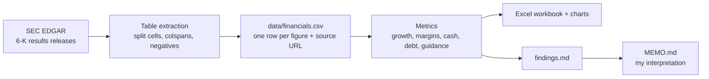
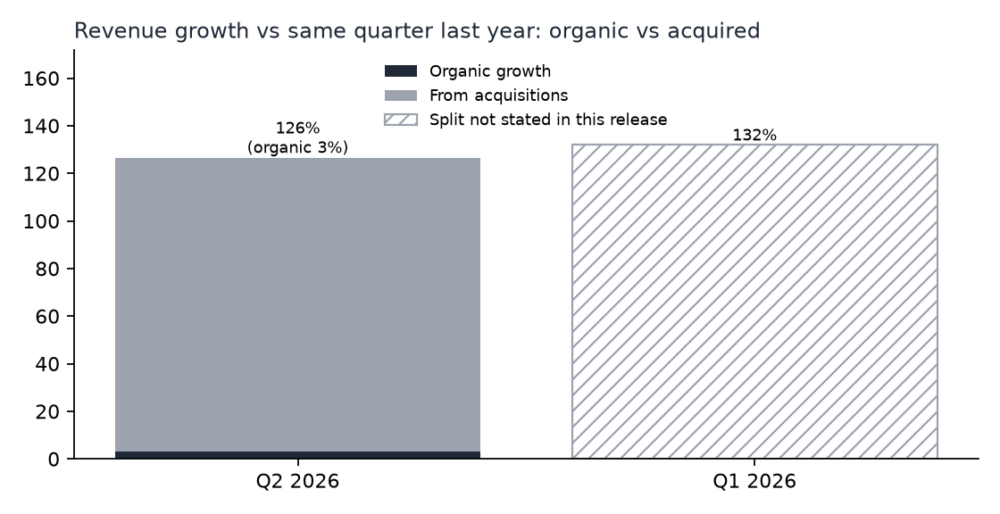
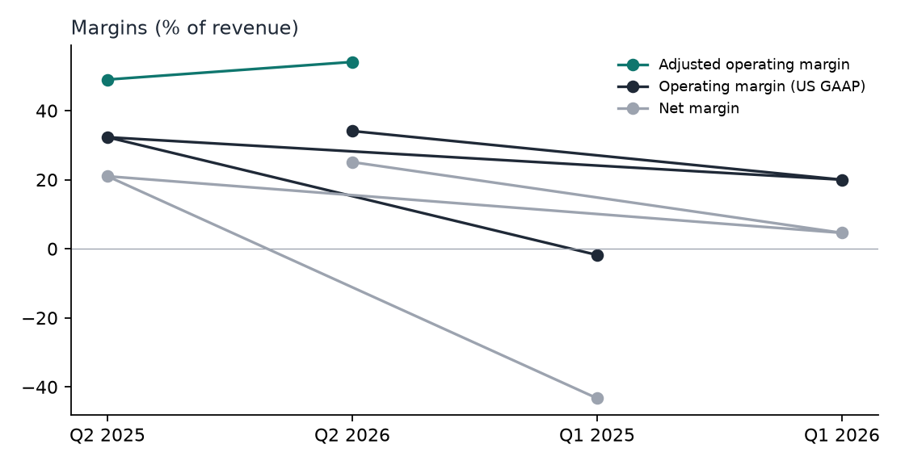
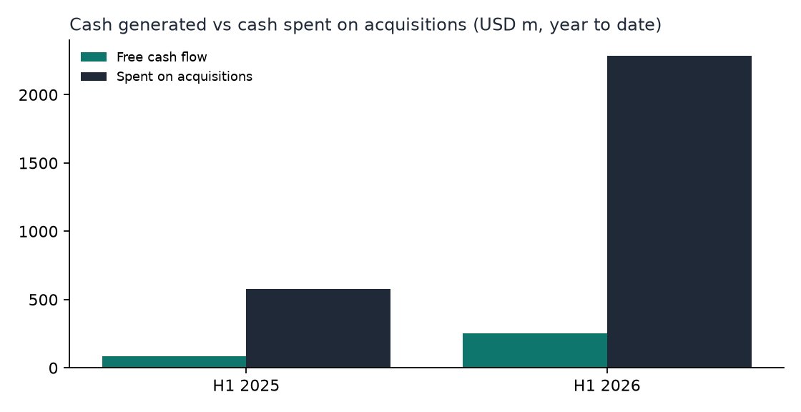

# What Bending Spoons' numbers say

An analysis of Bending Spoons S.p.A. (Nasdaq: BSP) built straight from its SEC filings. A Python pipeline downloads
every quarterly results release (Form 6-K, exhibit 99.1), extracts the income statement, balance sheet, cash flow
statement and non-GAAP reconciliations into one table **with a link to the source filing for every figure**, and
answers five questions:

1. **Growth:** how much is organic, and how much is bought through acquisitions?
2. **Profitability:** how far apart are US GAAP and adjusted operating margins, and what fills the gap?
3. **Cash:** does profit turn into cash, and how does free cash flow compare with acquisition spend?
4. **Debt:** how much debt funds the acquisitions, and how well do earnings cover the interest?
5. **Guidance:** what does full-year guidance imply for the rest of the year?

My conclusions are in **[MEMO.md](MEMO.md)**. The numbers behind them are below and in
`output/bending_spoons_analysis.xlsx`.



## Results

<!-- RESULTS:START -->
| Quarter | Revenue ($m) | Growth YoY | Organic | Op. margin | Adj. op. margin | Net margin | Interest cover |
|---|---|---|---|---|---|---|---|
| Q1 2025 | 258.9 | n/a | n/a | -1.8% | n/a | -43.3% | -0.2x |
| Q2 2025 | 311.1 | n/a | n/a | 32.3% | 49.0% | 21.0% | 2.8x |
| Q1 2026 | 601.3 | 132.2% | n/a | 20.0% | n/a | 4.6% | 1.3x |
| Q2 2026 | 704.2 | 126.3% | 3.0% | 34.1% | 54.1% | 25.1% | 2.2x |





## 1. Growth: bought or organic?
- Q2 2026: revenue $704m, up 126.3% year on year; organic growth 3.0%, so about 123.3 points of the growth came from acquisitions.

## 2. Profitability: US GAAP vs adjusted
- Q2 2026: operating margin 34.1% (US GAAP) vs adjusted 54.1%: a 20.0-point gap. Amortisation of acquired intangibles is 11.7% of revenue and reorganisation costs 7.2%.
- Interest coverage (operating income / interest expense): 2.2x.

## 3. Does profit turn into cash?
- H1 2026: operating cash flow $254m, capex $4m, free cash flow $250m (19.2% of revenue); operating cash flow / net income = 1.24x. Under US GAAP, interest paid is already deducted inside operating cash flow.
- Acquisitions cost $2,286m in the same period (9.1x free cash flow), funded with $2,566m of new debt; interest paid $161m.

## 4. Debt and balance sheet
- Net debt $2,041m (2025-12-31) -> $4,088m (2026-06-30); debt / equity 2.68x -> 3.88x.
- Goodwill and intangibles are 78.2% of total assets.
- Net debt / annualised adjusted operating income: 2.68x (proxy; the company's own leverage ratio uses adjusted EBITDA).

## 5. Guidance
- From the Q2 2026 release: Q3 2026 revenue $733m–$745m (midpoint $739m).
- From the Q2 2026 release: FY 2026 revenue $2,780m–$2,820m (midpoint $2,800m).
- Implied Q4 2026 revenue = FY midpoint − (H1 actual + Q3 guidance midpoint) = $756m.

## Questions for the analyst (answer these in the memo, in your own words)
1. Is 3% organic growth a problem for a company valued on its acquisition engine? What would you watch next quarter?
2. Which adjustments between GAAP and adjusted operating income are truly one-off, and which recur every quarter?
3. Free cash flow covers only a fraction of acquisition spend. What happens if debt markets tighten?
4. Does the implied Q4 revenue look achievable given the quarterly run-rate and the pending acquisitions?
5. If you were on the finance team, which single number would you want to improve first, and how?

<!-- RESULTS:END -->

## How the numbers are checked

- Every figure in `data/financials.csv` keeps the URL of the filing it came from; the Excel "Figures" sheet links to it.
- When a figure appears in several releases (prior-year comparatives), the latest release wins, so restatements are used.
- Q1 figures not reported on their own are derived as H1 − Q2 and match the company's published Q1 numbers.
- Tests check the extractor on SEC-style HTML (split "$" cells, negatives in brackets, column spans, section headers)
  and check computed metrics against figures Bending Spoons published.

## Definitions

| Metric | Definition |
|---|---|
| Growth from acquisitions | Reported year-on-year revenue growth minus the company's stated organic growth |
| Gap, adjusted vs GAAP | (Adjusted operating income − operating income) / revenue |
| Free cash flow | Operating cash flow − purchases of property, plant, equipment and intangible assets (operating cash flow is after interest paid, as US GAAP requires) |
| Cash conversion | Operating cash flow / net income |
| Net debt | Long-term debt (current + non-current) − cash and cash equivalents |
| Leverage (proxy) | Net debt / (latest quarter's adjusted operating income × 4); the company's own ratio uses adjusted EBITDA |
| Interest coverage | Operating income / interest expense |

## Run it

```
python3 run_and_push.py --run        # free: downloads public SEC filings, about 1 minute
```

Data: public SEC EDGAR filings by Bending Spoons S.p.A. (CIK 2004711); its statements are prepared under US GAAP. This is an independent student analysis, not
investment advice, and is not affiliated with Bending Spoons.
